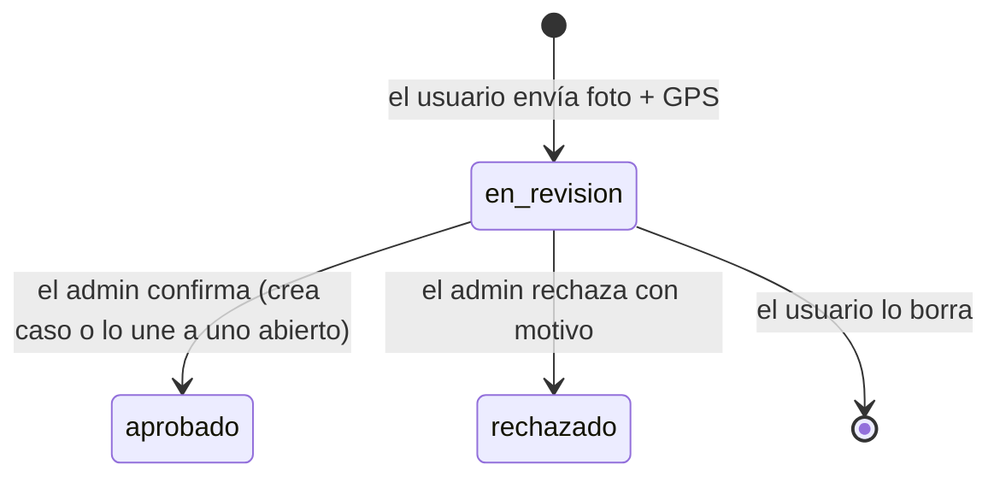
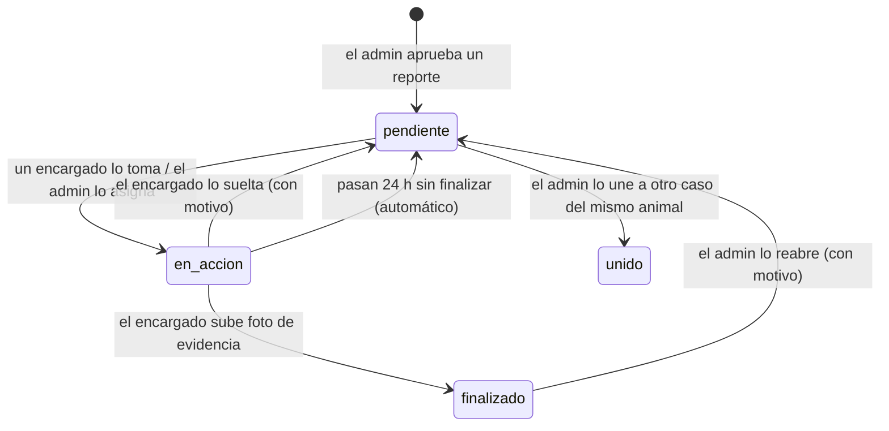

# Huellas en la Vía · Documento de diseño

Versión 0.1 · octubre 2026 · Huellas en la Vía by KPSB

## Objetivo

Que ningún animal muerto en las calles del Ecuador quede olvidado: cualquier persona lo reporta con foto y ubicación, un administrador confirma que es real y un encargado de la zona lo levanta. Primero Ecuador, después otros países.

## Roles

| Rol | Cómo llega | Qué hace | Requisitos |
|---|---|---|---|
| **Usuario** | Se registra solo (Google o cualquier correo) | Reporta, ve sus reportes y el mapa de su cantón | Correo verificado, nombre, celular, cantón y aceptar la política de privacidad |
| **Encargado** | Lo invita un administrador, con uno o varios cantones | Ve los casos aprobados de sus cantones, los toma, los suelta o los finaliza | Lo anterior + verificación en dos pasos |
| **Administrador** | Lo nombra otro administrador (el primero, por SQL) | Aprueba o rechaza reportes, une duplicados, asigna, reabre, gestiona personas | Lo anterior + verificación en dos pasos |

Puede haber varios administradores. Un administrador no puede cambiar su propio rol ni bloquearse a sí mismo, así siempre queda alguien con acceso.

## Reporte y caso

Un **reporte** es lo que sube un usuario. Un **caso** es el animal que atienden los encargados. Un caso puede reunir varios reportes del mismo animal; así los encargados no van dos veces al mismo lugar.

### Revisión del reporte

Si el administrador marca el rechazo como **reporte falso**, el usuario suma una advertencia. Al llegar a `advertencias_para_bloqueo` la cuenta queda bloqueada para reportar.

### Vida del caso

Reglas:

- **Tomar:** solo un encargado del cantón. Si dos tocan a la vez, solo uno lo consigue (la actualización exige `estado = 'pendiente'`).
- **Soltar:** motivo obligatorio: *No corresponde a mi jurisdicción*, *No puedo llegar* u *Otro* (con nota). Si es por jurisdicción, a ese encargado ya no le vuelve a aparecer el caso.
- **Asignar:** el administrador puede dárselo a cualquier encargado, aunque sea de otra zona. Eso anula una exclusión previa.
- **Liberación automática:** `pg_cron` revisa cada 15 minutos y devuelve a pendiente lo que lleva más de `horas_auto_soltar` en acción.
- **Finalizar:** exige una foto de evidencia ya subida a la carpeta del encargado. No necesita confirmación del administrador, pero este puede reabrir el caso; la evidencia anterior queda en el historial.
- **Unir:** el caso que se une debe estar pendiente. Sus reportes pasan al caso principal.

### Duplicados

Al revisar un reporte, la base sugiere:

- **casos abiertos** (pendientes o en acción) a menos de `duplicados_metros`, y
- **otros reportes en revisión** a menos de `duplicados_metros` y con menos de `duplicados_horas` de diferencia.

El administrador une con un clic: "Aprobar y unir a este caso" o "Aprobar ambos como un caso".

## Qué ve cada quien

| Dato | Usuario | Encargado | Administrador |
|---|---|---|---|
| Sus propios reportes y su avance | Sí | Sí | Sí |
| Reportes de otros en revisión | No | No | Sí |
| Casos de su cantón en el mapa (sin autor) | Sí | — | — |
| Casos y fotos de sus cantones | No | Sí | Sí, de todo el país |
| Nombre y celular de quien reporta | No | **No** | Sí |
| Historial del caso | No | De sus casos | Sí |

## Seguridad

La regla de diseño: **el navegador no es de confianza**. Todo lo que importa se valida en la base de datos.

1. **Row Level Security** en todas las tablas. Las políticas usan funciones `security definer` con `search_path` fijo.
2. **Escrituras solo por funciones.** Las tablas `casos`, `historial`, `zonas` y `configuracion` no tienen permiso de escritura para la app. Cambiar un estado solo es posible llamando a `aprobar_reporte`, `tomar_caso`, `soltar_caso`, `finalizar_caso`, etc., que verifican rol, 2FA y estado.
3. **Permisos por columna.** En `perfiles` el usuario solo puede cambiar `nombre`, `telefono`, `canton_id` y aceptar la privacidad. El rol, las advertencias y el bloqueo no se pueden tocar aunque una política quedara mal.
4. **El rol nunca viene del registro.** El disparador que crea el perfil solo toma el nombre de los metadatos.
5. **2FA obligatorio en la base.** `es_admin()` y `es_encargado()` exigen `aal2` en el token. Sin el segundo factor, la base rechaza sus acciones aunque se salte la pantalla de la app.
6. **Campos que fija el servidor.** Al crear un reporte, un disparador fuerza `usuario_id`, `estado` y fechas, y aplica el límite diario con un bloqueo para que dos envíos simultáneos no lo burlen.
7. **Fotos privadas.** Buckets privados, solo JPEG de hasta 3 MB, cada quien sube solo a su carpeta y se ven con enlaces firmados de 10 minutos.
8. **Sin metadatos ocultos.** La foto se recorta y se vuelve a codificar en el celular, lo que elimina el EXIF (ubicación de la casa, modelo del teléfono).
9. **Solo cámara en vivo.** No se puede elegir una foto de la galería.
10. **Captcha opcional** (Cloudflare Turnstile) en registro, inicio de sesión y recuperación.
11. **Cabeceras de seguridad** en `public/_headers`: CSP, HSTS, `X-Frame-Options`, y permisos de cámara y ubicación solo para la propia app.
12. **Clave de servicio** solo dentro de las Edge Functions, nunca en el navegador.
13. **Fotos sensibles difuminadas** hasta que la persona decide verlas.

Las pruebas de `scripts/probar-bd/` comprueban cada uno de estos puntos con identidades de prueba.

## Sin señal

La pantalla de reporte guarda la foto, la ubicación y la hora del momento en el celular (IndexedDB) si no hay conexión. Al volver la señal se envían solas. El id del reporte se genera en el celular, así un envío cortado a la mitad no crea duplicados. Un reporte con foto de más de `dias_maximos_reporte` días se rechaza.

## Privacidad (LOPDP)

- Datos mínimos: correo, nombre, celular y cantón. No se pide cédula.
- La aceptación de la política queda registrada con la hora del servidor.
- El encargado no ve quién reportó; el usuario tampoco ve a otros reportantes.
- Derecho de eliminación: el usuario borra su cuenta desde Perfil. Sus reportes en revisión se eliminan; los aprobados quedan anónimos porque son parte de casos atendidos.
- La política de privacidad en `src/paginas/Privacidad.tsx` es un **borrador**: completa responsable, contacto, región del servidor y plazos de conservación antes de publicar.

## Pendiente para próximas versiones

- Notificaciones push a encargados cuando entra un caso en su zona y al usuario cuando su caso avanza.
- Detectar el cantón automáticamente desde el GPS.
- Panel de estadísticas para presentar al GAD (puntos críticos por cantón).
- Inicio de sesión con Apple (requiere cuenta de desarrollador de Apple, USD 99 al año).
- Verificación del celular por SMS.
- Publicación en Play Store como app nativa (por ejemplo, empaquetando la PWA con Trusted Web Activity).
- Soporte para otros países: agregar su división territorial y el formato de teléfono.
